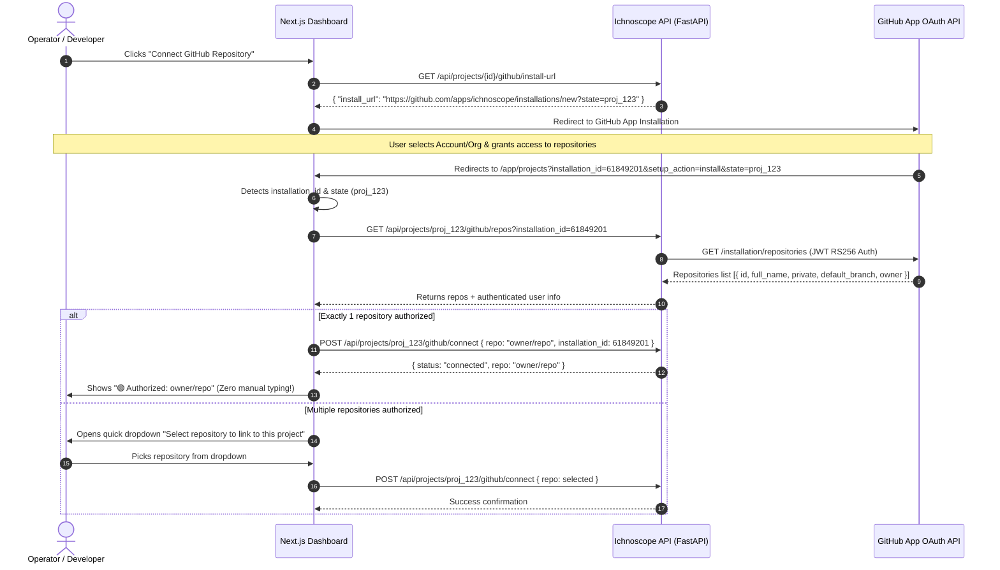
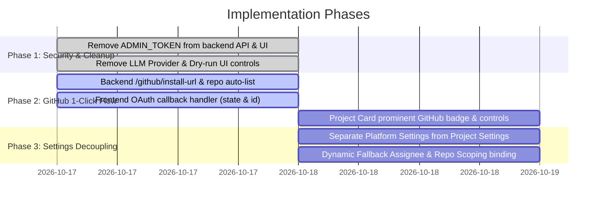

# Architecture & Solution Blueprint: GitHub 1-Click Integration & Settings Decoupling

## Executive Summary

This document establishes the comprehensive solution for resolving the 4 usability, automation, security, and architectural issues in Ichnoscope:
1. **Project Card GitHub Authorization UI Clarity**: Eliminating visual clutter, removing non-essential buttons, and making the GitHub authorization status and action prominent.
2. **1-Click GitHub App Authorization & Automatic Repository Discovery**: Eliminating manual 2-step setup and text inputs (`owner/repo` and installation IDs); automatically pulling repositories and user credentials upon OAuth redirect with live status, revocation, and management controls.
3. **Microservice-Level Settings Sanitization & Auto-Population**: Automatically scoping repositories and assignees, removing hardcoded defaults (`vanshikarana06`), removing internal LLM/dry-run options, and purging internal `ADMIN_TOKEN` disclosures.
4. **Platform (Fleet) vs. Project-Level Settings Hierarchy**: Clearly partitioning global organization-wide policies (Deterministic Severity Rules & Fleet Gate Baselines) from project-specific configurations (Repository Scoping, Path Prefix, and Service Alert Channels).

---

## 1. Issue 1: Project Card UI & GitHub Authorization Button Clarity

### 1.1 Problem Analysis (Image 1)
In the current project card (`web/src/app/app/projects/page.tsx`):
- **Hidden in Footer**: The GitHub connect action is relegated to a tiny, low-contrast button (`[Connect GitHub Repo]`) in the card footer next to `Slack Alerts` and `Rate Quota`. Users cannot readily determine how to authorize agent codebase access.
- **Header Clutter**: The card header contains duplicate/unwanted buttons (`Refresh icon`, `SDK Snippets` icon) that distract from critical actions.
- **Ambiguous Status**: When not connected, there is no visual indicator explaining why GitHub connection is required (e.g. GraphQL git blame, commit correlation, auto-triage PRs). When connected, it lacks an unambiguous green status badge and direct repo link.

### 1.2 Enterprise Production UI Design Specification

The microservice card is overhauled from a loose collection of disparate buttons into a structured, production-grade enterprise service block (mirroring patterns from Vercel, Datadog, and Sentry):

```
+-----------------------------------------------------------------------------------------------------------------------+
|  [D]  Iot Service                      [ ● PRODUCTION ]  [ ● Operational ]                                             |
|       ID: proj_ba8b0941 • Created: 2 days ago                                                                         |
|                                                                                                                       |
|  [ ACTIONS ]                                                                                                          |
|  [ ⚡ Open Service Dashboard ↗ ]    [ 📋 View Incidents ]    [ ⚙ Service Settings ]    [ 🗑️ Delete Service ]           |
+-----------------------------------------------------------------------------------------------------------------------+
|  INGESTION ENDPOINTS & CREDENTIALS                                                                                    |
|  +--------------------------------------------------------+  +-----------------------------------------------------+  |
|  | Sentry-Compatible DSN (SDK Target)                     |  | Telemetry Public Key                                |  |
|  | https://pk_live_ba8b0941...@ingest.ichnoscope.io/8080   |  | pk_live_ba8b0941_29b3d8b3216b5caa                   |  |
|  | [ Copy DSN ]   [ <> Quick SDK Snippets ]                |  | [ Copy Key ]                                        |  |
|  +--------------------------------------------------------+  +-----------------------------------------------------+  |
+-----------------------------------------------------------------------------------------------------------------------+
|  SOURCE CODEBASE & AUTONOMOUS AGENT TRIAGE                                                                            |
|                                                                                                                       |
|  [STATE A: DISCONNECTED - REPOSITORY NOT BOUND]                                                                       |
|  ┌─────────────────────────────────────────────────────────────────────────────────────────────────────────────────┐  |
|  │ ○ Repository Not Connected                                                                                      │  |
|  │ Required for automated GraphQL blame, diff inspection, and GitHub issue publishing.                            │  |
|  │ [ 🐙 Connect GitHub Repository ]                                                                                │  |
|  └─────────────────────────────────────────────────────────────────────────────────────────────────────────────────┘  |
|                                                                                                                       |
|  [STATE B: CONNECTED & AUTHORIZED]                                                                                    |
|  ┌─────────────────────────────────────────────────────────────────────────────────────────────────────────────────┐  |
|  │ ● Active & Authorized                                                                                           │  |
|  │ Repository: github.com/bitroom-cat/iot-service [↗]   •   Branch: main   •   App ID: 61849201                    │  |
|  │ Fallback Assignee: @satyam   •   Path Strip: /app/                                                              │  |
|  │ [ 🔄 Switch Repo ]          [ ⚙ Manage on GitHub ↗ ]          [ 🚫 Revoke Access ]                               │  |
|  └─────────────────────────────────────────────────────────────────────────────────────────────────────────────────┘  |
+-----------------------------------------------------------------------------------------------------------------------+
|  SLACK DISPATCH: #iot-alerts (Dedicated Channel)       RATE QUOTA: 120 req/min (Normal)       WORKSPACE: Tenant 2     |
+-----------------------------------------------------------------------------------------------------------------------+
```

### 1.3 Key UI Modifications & Action Hierarchy
1. **Dedicated Service Dashboard CTA**:
   - Added `[ ⚡ Open Service Dashboard ↗ ]` as the prominent primary action. Clicking it routes directly into that specific microservice’s dashboard view (`/app/dashboard?project_id=proj_ba8b0941`), displaying scoped telemetry, gate queues, incident metrics, and active AI investigation runs.
2. **Strict Action Tiering (Eliminating Unwanted Clutter)**:
   - **Primary Action**: `Open Service Dashboard` (High visual weight, solid accent button).
   - **Secondary Actions**: `View Incidents` (Secondary outline button) and `Service Settings` (Direct jump to microservice configuration).
   - **Destructive Action**: `Delete Service` (Muted red icon with confirmation modal).
   - **Removed**: Redundant manual refresh button (real-time data utilizes automatic query revalidation).
   - **Relocated**: `SDK Snippets` is placed contextually alongside the Sentry DSN copy action instead of cluttering the top card navigation.
3. **Enterprise Typography & Status Badges**:
   - Status indicators utilize standard operational dot pills (`● PRODUCTION` in emerald badge, `● Operational` in teal badge).
   - Code credentials use monospaced, high-legibility formatting with explicit one-click copy feedback.

---

## 2. Issue 2: 1-Click GitHub App Authorization & Auto-Discovery

### 2.1 Problem Analysis (Image 2)
The existing modal forces the user through a manual, fragmented 2-step procedure:
1. User clicks "Install on GitHub", which opens an external GitHub tab.
2. User is then required to manually type `Repository Full Name (owner/repo)` into an input box and optionally locate an obscure `GitHub Installation ID`.
3. If the user makes a typo in `owner/repo` or does not know their installation ID, the integration silently fails or creates broken git blame references.

### 2.2 End-to-End 1-Click OAuth Architecture



### 2.3 Management & Revocation Controls
- **Live Status Display**:
  - Green indicator pill `🟢 Authorized`
  - GitHub App Name and Installation ID
  - Target repository with direct link to GitHub
- **Revoke Button**:
  - Clicking `[Revoke Access]` triggers `POST /api/projects/{projectId}/github/disconnect`.
  - Clears repository scoping and unbinds the installation ID from the project database record.
  - Instantly transitions UI back to State A (Disconnected).
- **Manage Permissions Button**:
  - Direct link to `https://github.com/settings/installations/{installation_id}` allowing the operator to add/remove accessible repos directly in GitHub.

---

## 3. Issue 3: Microservice / Project Settings Cleanup & Security

### 3.1 Problem Analysis (Images 3 & 4)
1. **Target Repository**: Was a raw text input with a hardcoded placeholder `vanshikarana06/ichnoscope_demo_we_app`.
2. **Fallback Assignee**: Defaulted to hardcoded `vanshikarana06` instead of dynamic user identity.
3. **LLM Explanation Provider & Dry-run mode (`DRY_RUN=true`)**: Exposed in user-facing settings, confusing operators with internal LLM model parameters.
4. **Security Leak of `ADMIN_TOKEN`**: The backend master token was serialized and rendered in the web UI with a reveal-toggle button.

### 3.2 Solution & Architectural Decisions

#### A. Automatic Repo & Assignee Fetching
- **Target Repository**: Read-only display of the verified GitHub repository obtained via the OAuth App connection. Includes a `[Change Repository]` selector if the installation grants access to multiple repos.
- **Fallback Assignee**:
  - Removed hardcoded default `vanshikarana06`.
  - Default value is dynamically populated with the authenticated GitHub user login (e.g. `vanshikarana06` or `satyam` or `iotbytehub`).
  - Left as an editable optional text field with placeholder: `"Defaults to your GitHub username"`.

#### B. Removal of LLM Explanation Provider & Dry-Run Mode
| Setting | Why It Must Be Removed From User Settings | Proper Location |
| :--- | :--- | :--- |
| **Primary Model Provider** (`Gemini 1.5 Flash`) | End-users manage services and crashes, not LLM routing. The model selection is a platform-level infrastructure concern governed by backend compute keys. | Backend environment variables (`PRIMARY_MODEL_PROVIDER=gemini-1.5-flash`). |
| **Dry-Run Mode** (`DRY_RUN=true`) | Exposing this toggle invites accidental suppression of live incident creation and GitHub issue creation. | Backend deployment staging flags (`ICHNOSCOPE_DRY_RUN=false`). |

#### C. Purging `ADMIN_TOKEN` From Client Presentation
- **Security Hazard**: Exposing the administrative token in the browser allows any authenticated tenant or team member to extract master API privileges.
- **Implementation**:
  1. Remove `admin_token` from the backend `/api/settings` GET response model.
  2. Completely delete the `Security & Admin Token` section from `web/src/app/app/settings/page.tsx`.
  3. Master token validation remains strictly server-to-server or secured in `.env`.

---

## 4. Issue 4: Platform (Fleet) Settings vs. Microservice Settings Decoupling

### 4.1 Problem Analysis
Currently, global platform settings and service-specific configurations are aggregated into a single monolithic screen. This causes confusion because:
- Some settings are **universal organization rules** that must apply identically across every microservice.
- Other settings are **microservice-specific** and must be configured per project.

### 4.2 Decoupled Settings Architecture

```
+---------------------------------------------------------------------------------------------------+
|                                     SETTINGS ARCHITECTURE                                         |
+---------------------------------------------------------------------------------------------------+
|                                                                                                   |
|  [ LEVEL 1: PLATFORM / FLEET SETTINGS ]                     [ LEVEL 2: MICROSERVICE SETTINGS ]    |
|  (Applies cluster-wide to all services)                     (Applies to individual project)       |
|                                                                                                   |
|  1. Deterministic Severity Rules (Classifier)               1. Repository Scoping & GitHub App    |
|     - P1 Users / Events threshold (≥50 users / ≥100 events)    - Target Repository (owner/repo)   |
|     - P2 Users / Events threshold (≥10 users / ≥20 events)    - Path Prefix Strip (/app/)         |
|     * Mathematical rules applied across all microservices     - Regression Window (24h)           |
|                                                               - Fallback Assignee (User Login)    |
|  2. Server B Automation Policy Engine (Baseline)                                                  |
|     - Default Core Gate Control (Manual, Auto-AI, Full)     2. Slack & Alert Dispatch             |
|     - Auto-Dispatch Rule Set (Production Escalation,           - Service Webhook URL / Channel    |
|       Staging Filter, Noise Suppressor)                       - Custom incident alert routing     |
|                                                                                                   |
|                                                             3. Service Gate Override (Optional)   |
|                                                               - Override platform gate baseline   |
+---------------------------------------------------------------------------------------------------+
```

### 4.3 Detailed Field Distribution

#### Level 1: Platform / Fleet Settings (`/app/settings`)
1. **Deterministic Severity Classifier**:
   - `P1 Users Threshold` (e.g. 50 in prod)
   - `P1 Events Threshold` (e.g. 100 in prod)
   - `P2 Users Threshold` (e.g. 10 in prod)
   - `P2 Events Threshold` (e.g. 20 in prod)
   - *Rationale*: Incident severity criteria must be consistent across the entire engineering organization.
2. **Server B Fleet Automation Policy Engine**:
   - Default Gate 1 & Gate 2 baseline behavior.
   - Global dispatch rules (e.g. noise suppression).

#### Level 2: Microservice / Project Settings (`/app/projects/[id]/settings` or Project Modal)
1. **Repository Scoping**:
   - Target GitHub Repository (auto-selected via 1-click install).
   - Fallback Assignee (defaults to authenticated user).
   - Path Prefix Strip (e.g. `/app/` or `/srv/api/`).
   - Regression Window (hours).
2. **Slack & Dispatch Notifications**:
   - Service-specific Incoming Webhook URL.
   - Dedicated channel assignment (e.g. `#iot-alerts` vs `#billing-alerts`).
3. **Optional Project Gate Override**:
   - Allows high-risk services to enforce `Manual Approval Mode` while standard services run on the fleet default `Auto-AI Mode`.

---

## 5. Technical Implementation Roadmap



### 5.1 Exact Backend Changes Required
1. `backend/ichnoscope/api.py`:
   - In `GET /api/settings`: remove `admin_token` from serialized payload.
   - Ensure `GET /api/projects/{project_id}/github/repos` takes `installation_id` and queries GitHub App credentials.
   - Update `POST /api/projects/{project_id}/github/connect` to save `github_repo`, `github_installation_id`, and `fallback_assignee`.
2. `backend/ichnoscope/config.py`:
   - Remove hardcoded `vanshikarana06` default fallback assignee.

### 5.2 Exact Frontend Changes Required
1. `web/src/app/app/projects/page.tsx`:
   - Refactor project card with high-visibility GitHub section.
   - Remove manual `owner/repo` text inputs; replace with 1-click OAuth redirect and dynamic repo selector.
   - Support `useEffect` hook to capture `installation_id` from GitHub redirect URL and auto-bind repo.
2. `web/src/app/app/settings/page.tsx`:
   - Retain only **Platform Settings** (Deterministic Severity Rules & Automation Gate baseline).
   - Remove `Security & Admin Token`, `LLM Explanation Provider`, and `Dry-run mode`.
   - Move `Repository Scoping` and `Slack Webhook` into project-specific context.

---

## 6. Verification and Validation Checklist
- [ ] **Project Card**: GitHub button is prominent, distinct, and immediately visible; clutter buttons removed.
- [ ] **1-Click OAuth**: User clicks "Connect GitHub", authorizes on GitHub, and returns with repo automatically selected without typing.
- [ ] **Revoke & Manage**: User can click "Revoke" to disconnect or "Manage" to configure repo access on GitHub.
- [ ] **Privacy**: `ADMIN_TOKEN` is never visible in network payload or UI DOM.
- [ ] **Fleet vs Project**: Deterministic severity rules apply fleet-wide, while repo and Slack channels are isolated per microservice.
