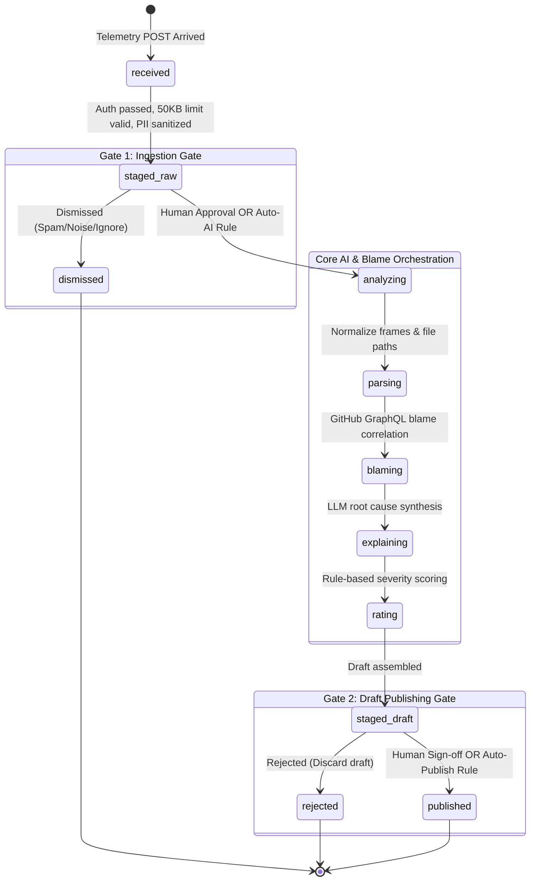

# Ichnoscope v2: Upgraded Architecture & Implementation Specification

**Autonomous Incident Intelligence Platform with Dual-Gated Triage, Self-Hosted Telemetry Ingestion, and Policy Control Center**

| Metadata | Details |
| :--- | :--- |
| **Document Version** | 2.1.0-PROD |
| **Status** | Approved Architecture & Implementation Blueprint |
| **System Classification** | Autonomous Incident Triage & Telemetry Pipeline |
| **Scope** | Dual-Gated Pipeline, Ingestion Gateway, Sentry/GlitchTip SDK Sensor, Control Center |

---

## 1. System Vision & Core Objectives

### 1.1 The Operational Problem
In previous iterations, error ingestion was coupled directly to AI execution:
1. **Uncontrolled LLM Token Burn:** Every unhandled exception or crash immediately fired blame queries and LLM root-cause prompts without human filtering or cost guards.
2. **Broken Human-in-the-Loop (HITL):** Human intervention only occurred at the very end of the pipeline (publish issue), meaning junk errors, crawler pings, and transient timeouts still consumed compute, token quotas, and database storage.
3. **Telemetry Vendor Lock-in & Bloat:** External SaaS collectors inject tracing overhead, performance profiling, and bloated JSON envelopes that waste bandwidth and introduce sensitive data exposure risks.

### 1.2 The Upgraded Architecture Solution
The upgraded architecture decouples ingestion, AI orchestration, and issue dispatch into a **Dual-Gated, Staged Transactional Pipeline**:
* **Staged Error Catching Pipeline:** A dedicated in-house microservice acts as a lightweight, Sentry/GlitchTip-compatible telemetry collector.
* **Gate 1 (Pre-AI Ingestion Staging):** Errors are staged upon arrival (`staged_raw`). Human operators review whether an error warrants deep AI analysis, or policy automation rules automatically advance high-priority incidents.
* **AI Orchestration Engine:** Multi-stage deterministic blame correlation combined with structured LLM root-cause synthesis.
* **Gate 2 (Post-AI Draft Issue Staging):** The generated GitHub issue, root-cause hypothesis, and verification checklist are staged (`staged_draft`) for interactive preview, editing, and publishing.
* **Control Center:** A centralized policy configuration interface to toggle automation modes (Full Manual, Semi-Autonomous, Autonomous) globally or by environment and severity.

---

## 2. End-to-End System Architecture & Physical Deployment Topology

The upgraded architecture enforces a strict **physical and network separation** between the public-facing edge telemetry sensor and the internal control center.

### 2.1 Multi-Server Topology

```
===================================================================================================
PUBLIC INTERNET / APPLICATION VPC
===================================================================================================
                                      |
                                      | 1. HTTP POST (Envelope / JSON, max 50KB)
                                      |    from Client App (GlitchTip / Sentry SDK)
                                      v
===================================================================================================
[ SERVER A: STANDALONE EDGE INGESTION GATEWAY ] (Edge Cluster / Public DMZ)
===================================================================================================
| - Physical Isolation: Dedicated container/VM; completely separated from dashboard & DB       |
| - Attack & DoS Defense: Block oversized bodies (>50KB), malicious payloads, injection attacks   |
| - DSN & Token Authenticator: Validates project public key / `X-Ignoscope-Token`                |
| - Leaky-Bucket Rate Limiter: Per-IP and per-Project request throttling                         |
| - Edge PII Sanitizer: Pre-scrubs credentials, JWTs, authorization headers, passwords, emails  |
| - Fast ACK to Client: Immediately returns HTTP 202 Accepted (<25ms)                            |
| - Secure Forwarder: Delivers clean, normalized payload to internal core via HMAC/mTLS         |
===================================================================================================
                                      |
                                      | 2. Secure Inter-Service Forwarding
                                      |    POST /internal/v1/incidents/ingress
                                      |    Header: X-Internal-Gateway-Secret
                                      v
===================================================================================================
[ SERVER B: MAIN DASHBOARD & ORCHESTRATION SERVER ] (Internal Network / Core)
===================================================================================================
|
|  +------------------------------------------------------------------------------------------+
|  |                            STAGE 1: INGESTION STAGING QUEUE                              |
|  |             Error arrives and is staged first: Status: `staged_raw` (Gate 1)             |
|  +------------------------------------------------------------------------------------------+
|                                             |
|                     +-----------------------+-----------------------+
|                     |                                               |
|                     | [Manual Approval Mode]                        | [Auto-AI Mode / Rule Match]
|                     v                                               v
|  +-------------------------------------+         +-------------------------------------+
|  |       CONTROL CENTER (GATE 1)       |         |        AUTO-DISPATCH ENGINE         |
|  | - Operator reviews raw crash inbox  |         | - Rule match: e.g. P1 / Production  |
|  | - [Approve for AI] or [Dismiss/Spam]|         | - Advances directly to AI pipeline  |
|  +-------------------------------------+         +-------------------------------------+
|                     | (Approved)                                    |
|                     +-----------------------+-----------------------+
|                                             |
|                                             | 3. Trigger Asynchronous AI Triaging
|                                             v
|  +------------------------------------------------------------------------------------------+
|  |                         AI & GIT ORCHESTRATION PIPELINE (Server B)                       |
|  | 1. Stack Normalizer: Extracts failing in-app file path, line number, and stack frame     |
|  | 2. Deduplication Engine: SHA-256 fingerprinting & duplicate suppression                  |
|  | 3. GitHub Blame Correlator: Fetches suspect commit, diff, and PR owner via GraphQL       |
|  | 4. LLM Root-Cause Synthesizer: Generates hypothesis and 3-point verification checklist   |
|  | 5. Severity Classifier: Scores impact level (P1-Critical, P2-High, P3-Medium)            |
|  +------------------------------------------------------------------------------------------+
|                                             |
|                                             | 4. Assemble Draft Issue
|                                             v
|  +------------------------------------------------------------------------------------------+
|  |                            STAGE 2: DRAFT ISSUE STAGING                                  |
|  |                      Status: `staged_draft` (Gate 2 Review Queue)                        |
|  +------------------------------------------------------------------------------------------+
|                                             |
|                     +-----------------------+-----------------------+
|                     |                                               |
|                     | [Manual / Semi-Auto]                          | [Full Auto Mode]
|                     v                                               v
|  +-------------------------------------+         +-------------------------------------+
|  |       CONTROL CENTER (GATE 2)       |         |         AUTO-PUBLISH ENGINE         |
|  | - Interactive Markdown Preview      |         | - High confidence (>=90%) & P1      |
|  | - Edit Title, Assignee, Checklist   |         | - Direct push to GitHub             |
|  | - [Approve & Publish] or [Reject]   |         +-------------------------------------+
|  +-------------------------------------+                                    |
|                     | (Approved)                                            |
|                     +-----------------------+-------------------------------+
|                                             |
|                                             | 5. Dispatch External APIs
|                                             v
|  +------------------------------------------------------------------------------------------+
|  |                            DISPATCH & NOTIFICATION ADAPTERS                              |
|  |  - GitHub API: Opens official issue with suspect commit, diff, hypothesis & assignee     |
|  |  - Slack Webhook: Posts actionable incident card with direct issue & run links          |
|  +------------------------------------------------------------------------------------------+
===================================================================================================
```

---

## 3. The Dual-Gated Pipeline Specification

### 3.1 State Machine Lifecycle
The complete incident lifecycle follows this formal state machine:



### 3.2 State Definitions

| State | Responsible Worker | Description | Permitted Next States |
| :--- | :--- | :--- | :--- |
| `received` | Ingestion Gateway | Payload arrived over HTTP, signature/token checked. | `staged_raw`, `failed` |
| `staged_raw` *(Gate 1)* | Database / Control Center | Raw error stored safely. Zero LLM tokens or Git API calls made. | `analyzing`, `dismissed` |
| `dismissed` | Human Operator | Dropped as noise/spam. Pipeline execution stops. | *Terminal* |
| `analyzing` | Worker Subsystem | Processing frame parsing, deduplication, blame, and LLM explanation. | `parsing`, `failed` |
| `staged_draft` *(Gate 2)* | Database / Control Center | Root cause and culprit identified. Complete GitHub issue markdown drafted. | `published`, `rejected` |
| `rejected` | Human Operator | Draft rejected by reviewer. Nothing published to GitHub. | *Terminal* |
| `published` | Publisher Engine | GitHub issue opened; fingerprint linked; Slack alert posted. | *Terminal* |
| `suppressed` | Deduplication Engine | Repeat error; frequency count incremented; repeat comment added if threshold met. | *Terminal* |
| `failed` | System Error Handler | Unhandled exception encountered during pipeline processing. | `analyzing` (Retry) |

---

## 4. Error Catching & Ingestion Gateway Specification

### 4.1 Ingestion Endpoints (Sentry / GlitchTip Compatible)

| Method | Route | Purpose | Payload Type |
| :--- | :--- | :--- | :--- |
| `POST` | `/api/{project_id}/store/` | Sentry v7 legacy store endpoint | Standard Sentry JSON |
| `POST` | `/api/{project_id}/envelope/` | Sentry v8+ modern envelope endpoint | Chunked multipart envelope |
| `POST` | `/api/v1/telemetry/ingest` | Native Ignoscope ingest endpoint | Standard JSON payload |

### 4.2 Standalone Gateway Microservice Design & Anti-Attack Guardrails (Server A)

The ingestion service is containerized and deployed on **Server A** as a hardened edge proxy. It runs zero database logic, zero LLM models, and zero GitHub client connections—serving purely as an attack-resistant shield for Server B.

```
+-----------------------------------------------------------------------------------------------+
|                       SERVER A: INGESTION GATEWAY GUARDRAIL PIPELINE                          |
+-----------------------------------------------------------------------------------------------+
|                                                                                               |
| 1. TLS Termination & Origin Filtering:                                                        |
|    - Strictly terminates HTTPS; drops non-TLS and malformed HTTP connections.                  |
|                                                                                               |
| 2. DoS & Slowloris Protection:                                                                |
|    - Request read timeout enforced at 2.5 seconds (drops slow HTTP attacks).                   |
|    - Strict Content-Length ceiling: >= 50KB immediately rejected with HTTP 413 Payload Too Large|
|                                                                                               |
| 3. Malicious Payload & Attack Vector Defense:                                                 |
|    - Enforces JSON depth limits (max nesting: 10 levels) to prevent parser stack overflow.    |
|    - Scans string inputs for SQL injection, remote code execution tokens, and shell payloads. |
|    - Truncates oversized stack traces (capped at 50 in-app frames).                            |
|                                                                                               |
| 4. Project DSN & Token Authentication:                                                        |
|    - Validates Project Public Key extracted from Sentry DSN or `X-Ignoscope-Token`.           |
|    - Rejects unauthorized or revoked project IDs with HTTP 401 Unauthorized.                   |
|                                                                                               |
| 5. Token-Bucket Rate Limiter (Redis or In-Memory Leaky Bucket):                               |
|    - Per-IP Limit: Max 60 requests/minute (blocks runaway client retry loops).                |
|    - Per-Project Limit: Max 120 requests/minute. Rejections return HTTP 429 Too Many Requests.|
|                                                                                               |
| 6. Edge DLP & PII Scrubbing Layer:                                                            |
|    - Scrubs passwords, bearer tokens, JWTs, AWS credentials, Slack tokens, emails, and PII.  |
|    - Redacts cookies, authorization headers, and sensitive environment variables.             |
|                                                                                               |
| 7. Instant ACK:                                                                               |
|    - Responds immediately to client with HTTP 202 Accepted {"status": "accepted"} (<25ms).     |
|                                                                                               |
| 8. Secure Inter-Server Forwarding Bridge (to Server B):                                       |
|    - Delivers sanitized, verified payload via internal HTTPS POST /internal/v1/incidents/ingress|
|    - Authenticated via pre-shared secret `X-Internal-Gateway-Secret` or mutual TLS (mTLS).    |
+-----------------------------------------------------------------------------------------------+
```

### 4.3 Inter-Service Ingress Contract (Server A -> Server B)

When Server A finishes validation and sanitization, it immediately forwards the normalized event to Server B's internal staging endpoint:

```http
POST /internal/v1/incidents/ingress HTTP/1.1
Host: core.ichnoscope.internal
Authorization: Bearer <SECURE_INTERNAL_GATEWAY_TOKEN>
X-Forwarded-From-Gateway: gateway-node-01
Content-Type: application/json

{
  "gateway_received_at": "2026-10-14T23:25:00Z",
  "project_id": "proj_prod_payments",
  "environment": "production",
  "client_ip_hash": "a8f3b9c02d1",
  "sanitized_payload": {
    "exception": {
      "values": [
        {
          "type": "KeyError",
          "value": "payment_method",
          "stacktrace": { ... }
        }
      ]
    },
    "tags": {
      "release": "a1b2c3d4e5f",
      "service": "checkout-api"
    }
  }
}
```

Upon receiving this request, **Server B** stages the record into the database as `staged_raw` (Gate 1), alerting the Control Center dashboard for operator review.

### 4.3 Client SDK Transport Configuration Profile
Client applications configure any official `@sentry/*` or GlitchTip SDK without third-party dependencies:

```typescript
// client-telemetry.ts
import * as Sentry from "@sentry/node"; // or @sentry/browser / @sentry/python

export function initTelemetry(serviceName: string, releaseCommit: string) {
  Sentry.init({
    // Point directly to self-hosted Ignoscope Ingestion Gateway
    dsn: "https://ignoscope_public_key@telemetry.yourcompany.internal/1",
    
    // Strip telemetry bloat (no performance or replay overhead)
    tracesSampleRate: 0.0,
    replaysSessionSampleRate: 0.0,
    replaysOnErrorSampleRate: 0.0,
    
    // Static context tags required for blame and repo correlation
    environment: process.env.NODE_ENV || "production",
    release: releaseCommit,
    
    // Client-side noise filtering before network transmission
    beforeSend(event, hint) {
      // 1. Filter out network disconnects or client cancellations
      const error = hint.originalException;
      if (error instanceof Error) {
        if (error.name === "AbortError" || error.message.includes("cancelled")) {
          return null;
        }
      }
      
      // 2. Strip sensitive environment tags
      if (event.request && event.request.headers) {
        delete event.request.headers["cookie"];
        delete event.request.headers["authorization"];
      }

      return event;
    },
  });
}
```

---

## 5. Control Center & Policy Automation Engine

### 5.1 Automation Matrix Modes

The Control Center provides three global operational modes:

| Mode | Gate 1 (Ingest -> AI) | Gate 2 (AI Draft -> Publish) | Intended Use Case |
| :--- | :--- | :--- | :--- |
| **Full Manual** | Manual Human Sign-off | Manual Human Sign-off | Staging environments, sensitive proprietary codebases, or token cost optimization. |
| **Semi-Autonomous** *(Default)* | **Automated** (Direct to AI) | **Manual Review** (Sign-off) | Standard production: AI prepares complete root cause analysis; human signs off before public issue creation. |
| **Fully Autonomous** | **Automated** | **Automated** | High-velocity on-call, P1 critical incidents with high culprit confidence ($\ge 90\%$). |

### 5.2 Granular Policy Rule Schema
Organizations configure dynamic rules to bypass or require gates conditionally:

```json
{
  "default_mode": "semi_autonomous",
  "rules": [
    {
      "name": "Production Critical Escalation",
      "condition": {
        "environment": "production",
        "severity": "P1-Critical"
      },
      "action": {
        "gate1": "auto_approve",
        "gate2": "auto_publish",
        "slack_alert": true
      }
    },
    {
      "name": "Staging Filter",
      "condition": {
        "environment": "staging"
      },
      "action": {
        "gate1": "require_manual",
        "gate2": "require_manual"
      }
    },
    {
      "name": "Noise Suppressor",
      "condition": {
        "exception_type": ["NotFoundHttpException", "ChunkLoadError"]
      },
      "action": {
        "gate1": "auto_dismiss"
      }
    }
  ]
}
```

---

## 6. Data Models & Database Schema

### 6.1 RunState Model Specification (`backend/ichnoscope/models.py`)

```python
from datetime import datetime, timezone
from typing import Literal
from pydantic import BaseModel, Field

RunStatus = Literal[
    "received",
    "staged_raw",     # Gate 1: Awaiting AI approval
    "dismissed",      # Dropped at Gate 1
    "analyzing",      # AI & Blame in progress
    "staged_draft",   # Gate 2: Awaiting publish approval
    "rejected",       # Dropped at Gate 2
    "published",      # Published to GitHub
    "suppressed",     # Repeat error deduplicated
    "failed",         # Execution failure
]

class GateApproval(BaseModel):
    approved_by: str | None = None
    approved_at: datetime | None = None
    reason: str | None = None

class RunState(BaseModel):
    payload: dict
    fingerprint: str = ""
    is_regression: bool = False
    status: RunStatus = "staged_raw"
    
    # Dual-Gate Auditing
    gate1_review: GateApproval | None = None
    gate2_review: GateApproval | None = None
    
    # Analysis Artifacts
    incident: Incident | None = None
    culprit: Culprit | None = None
    explanation: Explanation | None = None
    severity: Severity | None = None
    
    # Draft overrides (edited by human in Control Center)
    draft_title_override: str | None = None
    draft_body_override: str | None = None
    
    # Destination
    issue_url: str | None = None
    logs: list[str] = Field(default_factory=list)
```

### 6.2 Relational Database Schema (`ichnoscope.db`)

```sql
-- Pipeline Runs Table (Updated)
CREATE TABLE IF NOT EXISTS runs (
    run_id TEXT PRIMARY KEY,
    status TEXT NOT NULL,
    fingerprint TEXT,
    severity TEXT,
    is_regression INTEGER DEFAULT 0,
    issue_url TEXT,
    gate1_status TEXT DEFAULT 'pending', -- 'pending', 'approved', 'dismissed'
    gate1_reviewer TEXT,
    gate1_timestamp DATETIME,
    gate2_status TEXT DEFAULT 'pending', -- 'pending', 'approved', 'rejected'
    gate2_reviewer TEXT,
    gate2_timestamp DATETIME,
    created_at DATETIME DEFAULT CURRENT_TIMESTAMP,
    updated_at DATETIME DEFAULT CURRENT_TIMESTAMP,
    raw_payload TEXT NOT NULL,
    state_json TEXT NOT NULL
);

-- Automation Policy Table
CREATE TABLE IF NOT EXISTS automation_policies (
    policy_id TEXT PRIMARY KEY,
    name TEXT NOT NULL,
    is_active INTEGER DEFAULT 1,
    rule_config TEXT NOT NULL,
    created_at DATETIME DEFAULT CURRENT_TIMESTAMP
);

-- Telemetry Project Keys
CREATE TABLE IF NOT EXISTS project_keys (
    project_id TEXT PRIMARY KEY,
    name TEXT NOT NULL,
    public_key TEXT UNIQUE NOT NULL,
    secret_key TEXT NOT NULL,
    rate_limit_per_min INTEGER DEFAULT 120,
    created_at DATETIME DEFAULT CURRENT_TIMESTAMP
);
```

---

## 7. Control Center UI/UX Specifications

The Web Control Center (`web/src/app/app/runs/page.tsx`) features a staged triaging layout:

### 7.1 Multi-Stage Staging Board
* **Column 1: Raw Ingestion Inbox (Gate 1)**
  * Displays incoming raw crashes (`staged_raw`).
  * Shows: Exception name, failing file, environment, occurrence count.
  * Actions: `[Analyze with AI]` (green) | `[Dismiss Noise]` (grey).
* **Column 2: Active Orchestration**
  * Displays incidents currently running Git blame and LLM synthesis (`analyzing`).
  * Visual progress indicators: Git Blame Correlation -> LLM Synthesis -> Severity Rating.
* **Column 3: Draft Issue Review (Gate 2)**
  * Displays complete synthesized triage cards (`staged_draft`).
  * Interactive preview of markdown issue: Suspect commit, blame author, root cause hypothesis, 3-point checklist.
  * Inline editing of issue title, description, and assignee.
  * Actions: `[Sign-off & Open GitHub Issue]` | `[Reject Draft]`.
* **Column 4: Published Issues**
  * Displays successfully published issues with direct link to GitHub issue `#142` and Slack alert audit trail.

---

## 8. Phased Implementation Roadmap

### Phase 1: Decouple Pipeline Execution & Dual-Gated State Engine
* **Goal:** Enable the system to pause at Gate 1 and Gate 2 without executing full unmoderated runs.
* **Deliverables:**
  * Update `RunStatus` and `RunState` in `backend/ichnoscope/models.py`.
  * Refactor `backend/ichnoscope/pipeline.py` into distinct functional stages:
    * `ingest_and_stage(payload)`
    * `execute_investigation(run_id)`
    * `publish_draft(run_id, overrides)`
  * Implement Gate 1 & Gate 2 REST endpoints in `backend/ichnoscope/api.py`:
    * `POST /api/runs/{run_id}/gate1/approve`
    * `POST /api/runs/{run_id}/gate1/dismiss`
    * `POST /api/runs/{run_id}/gate2/approve`
    * `POST /api/runs/{run_id}/gate2/reject`

### Phase 2: Ingestion Gateway & Guardrail Microservice
* **Goal:** Turn Ichnoscope into a self-hosted Sentry/GlitchTip drop-in telemetry collector.
* **Deliverables:**
  * Add `/api/{project_id}/store/` and `/api/{project_id}/envelope/` endpoints in `backend/ichnoscope/main.py`.
  * Add 50KB request body size guardrail.
  * Add token/DSN authorization verification.
  * Connect `backend/ichnoscope/redact.py` to scrub raw payloads before saving to database.
  * Implement instant HTTP `202 Accepted` asynchronous decoupling.

### Phase 3: Control Center UI & Automation Settings Panel
* **Goal:** Deliver a modern frontend for staging control, manual approvals, and policy management.
* **Deliverables:**
  * Build Staging Inbox and Dual-Gate action triggers in `web/src/app/app/runs`.
  * Build interactive Markdown Issue Editor in `web/src/components/IssuePreview.tsx`.
  * Add Automation Mode toggle (`Manual`, `Semi-Auto`, `Full Auto`) in `web/src/app/app/settings`.

### Phase 4: Production Hardening, Testing & Documentation
* **Goal:** Validate resilience under error storms and zero PII leakage.
* **Deliverables:**
  * End-to-end integration test with sample client application firing crashes via Sentry SDK.
  * Load test 100 concurrent error bursts to verify rate limiting and duplicate suppression.
  * Verify PII redaction test suite across authorization tokens, passwords, and private keys.
