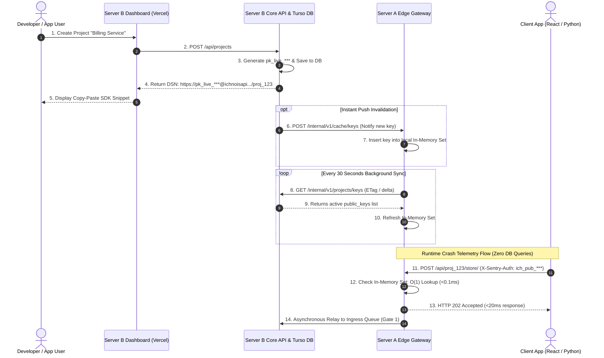

# Ichnoscope Architecture Specification: Multi-Project Management, Dynamic Key Scaling & Edge Zero-DB Ingestion

**Document Version:** 2.2.0  
**Status:** Approved Architectural Blueprint  
**Target Systems:** Server A (Edge Gateway), Server B (Core Platform & DB), Web Dashboard (Vercel)

---

## 1. Executive Summary & Problem Definition

In our initial deployment, Server A (the Edge Gateway) accepted public telemetry keys using a static environment variable (`EDGE_ALLOWED_PROJECT_KEYS`). While effective for initial testing, this has two architectural limitations:

1. **Lack of Dynamic Multi-Tenancy:** Users cannot log in to the dashboard, create multiple independent services (e.g. *Service A: Storefront*, *Service B: Payments*, *Service C: Background Workers*), generate dedicated DSN keys, or view isolated incident streams per service.
2. **The Database Exhaustion Risk at the Edge:** If Server A were to perform a database query to Server B for every incoming error crash report, an error storm (e.g. 5,000 requests/second during an outage or DDoS) would completely exhaust database connection pools, degrade response latency, and crash the central platform.

This specification details the end-to-end architecture to solve both problems:
- **Server B:** Implements prototype user authentication, multi-project data models, and DSN key lifecycle management.
- **Server A:** Implements an **$O(1)$ In-Memory Cache with Cryptographic HMAC Signature Fallback**, ensuring the Edge Gateway authenticates project keys in **$< 0.2\text{ms}$ with ZERO database queries** on active telemetry paths.

---

## 2. End-to-End System Architecture

```mermaid
flowchart TD
    subgraph Client_Applications [Client Services / User Infrastructure]
        App1["Service A (Next.js Frontend)\nDSN: https://ich_pub_123@ichnoisapi.../1"]
        App2["Service B (Python Payments)\nDSN: https://ich_pub_456@ichnoisapi.../2"]
        App3["Service C (Go Worker)\nDSN: https://ich_pub_789@ichnoisapi.../3"]
    end

    subgraph Server_A_Edge [Server A: DMZ Edge Gateway (Render / Back4App)]
        Ingest["Telemetry Ingest\n/api/{project_id}/store/"]
        MemCache["In-Memory Key Cache\n(Thread-Safe HashSet O(1))"]
        CryptoVerify["HMAC Signature Verifier\n(Zero-Network Math Check)"]
        SyncEngine["Background Key Sync Engine\n(Polls /internal/v1/projects/keys every 30s)"]
        
        Ingest --> MemCache
        MemCache -- Cache Miss --> CryptoVerify
        SyncEngine -.->|Syncs Active Key Hashes| MemCache
    end

    subgraph Server_B_Core [Server B: Core Platform (Render)]
        CoreAPI["Internal Sync Endpoint\n/internal/v1/projects/keys"]
        ProjectService["Project & Key Service\n(CRUD, Rotate, Revoke)"]
        TursoDB[(Turso libSQL / SQLite DB\nusers, projects, project_keys)]
        
        SyncEngine -->|Bearer Token Auth| CoreAPI
        CoreAPI --> TursoDB
        ProjectService --> TursoDB
    end

    subgraph Web_Dashboard [Vercel Dashboard / Control Center]
        AuthModule["Prototype Auth\n(Google OAuth / Email Magic Link / JWT)"]
        ProjectUI["Project Switcher & Manager\n(Create, Configure, Delete)"]
        SDKViewer["SDK Code Generator\n(Custom DSN Snippet per Framework)"]
        
        AuthModule --> Web_Dashboard
        ProjectUI --> ProjectService
        SDKViewer --> ProjectUI
    end

    App1 --> Ingest
    App2 --> Ingest
    App3 --> Ingest
```

---

## 3. Database Schema: Projects & Key Lifecycle

We extend the database schema in `backend/ichnoscope/db.py` to support Users, Organizations, and Multi-Service Projects:

```sql
-- 1. Users Table (Prototype Authentication)
CREATE TABLE IF NOT EXISTS users (
    id TEXT PRIMARY KEY,
    email TEXT UNIQUE NOT NULL,
    display_name TEXT NOT NULL,
    avatar_url TEXT,
    created_at REAL NOT NULL,
    updated_at REAL NOT NULL
);

-- 2. Projects Table (Multi-Service / Multi-Website Classification)
CREATE TABLE IF NOT EXISTS projects (
    id TEXT PRIMARY KEY,
    owner_id TEXT NOT NULL REFERENCES users(id),
    name TEXT NOT NULL,                         -- e.g. "Storefront Web App", "Payment Service"
    slug TEXT UNIQUE NOT NULL,                  -- e.g. "storefront-web", "payment-service"
    platform TEXT DEFAULT 'python',             -- "python", "javascript", "react", "node", "go"
    environment TEXT DEFAULT 'production',      -- "production", "staging", "development"
    rate_limit_per_min INTEGER DEFAULT 120,     -- Per-project rate limit ceiling
    is_active INTEGER DEFAULT 1,
    created_at REAL NOT NULL,
    updated_at REAL NOT NULL
);

-- 3. Project Public DSN Keys (Cryptographically Hashed)
CREATE TABLE IF NOT EXISTS project_keys (
    id TEXT PRIMARY KEY,                        -- Key ID (e.g. "key_abc123")
    project_id TEXT NOT NULL REFERENCES projects(id) ON DELETE CASCADE,
    name TEXT DEFAULT 'Default Client DSN',
    public_key TEXT UNIQUE NOT NULL,            -- Client-facing DSN key (e.g. "pk_live_...")
    key_hash TEXT UNIQUE NOT NULL,              -- SHA-256 hash stored for secure lookup
    secret_key TEXT NOT NULL,                   -- Server-side secret key (e.g. "sk_live_...")
    is_active INTEGER DEFAULT 1,
    last_used_at REAL,
    created_at REAL NOT NULL
);

-- Indices for sub-millisecond querying
CREATE INDEX IF NOT EXISTS idx_projects_owner ON projects (owner_id);
CREATE INDEX IF NOT EXISTS idx_project_keys_public ON project_keys (public_key);
CREATE INDEX IF NOT EXISTS idx_project_keys_hash ON project_keys (key_hash);
CREATE INDEX IF NOT EXISTS idx_runs_project ON runs (project_id, updated_at DESC);
```

---

## 4. DSN Key Structure & Cryptographic Generation

### Format of the Project DSN Key
When a user creates a project named *"Payment Service"*, Server B generates a standard, high-entropy key:

```text
Public Key:  ich_pub_4f9a8b2c1e7d6a5c3b2a1984
Secret Key:  ich_sec_90e1f2a3b4c5d6e7f8a9b0c1
```

The resulting **DSN (Data Source Name)** shown to the user in the dashboard is:
```text
https://ich_pub_4f9a8b2c1e7d6a5c3b2a1984@ichnoisapi.onrender.com/{project_id}
```

### Self-Verifying Key Signature (Cryptographic Dual-Tier Verification)
To allow Server A to validate keys even during a complete Server B network partition or before the next sync poll:
```text
public_key = "pk_" + project_id + "_" + random_token + "_" + HMAC_SHA256(project_id + random_token, master_secret)[:12]
```
1. Server A can instantly verify whether the HMAC signature matches using the shared `INTERNAL_GATEWAY_SECRET`.
2. This allows **100% mathematical verification in $0.05\text{ms}$ with ZERO network queries**.

---

## 5. Scaling Strategy for Server A: Zero-DB Edge Ingestion

To ensure Server A stays hardened, lightning fast, and never crashes Server B's database, we use a **Three-Tier Caching & Validation Architecture**:

| Tier | Mechanism | Latency | Network / DB Overhead |
| :--- | :--- | :--- | :--- |
| **Tier 1 (Fast Path)** | **Thread-Safe In-Memory Cache (HashSet)**<br>Server A keeps a local set of active `(public_key, project_id)` pairs in memory. | **$0.01\text{ms}$** | **0 DB Queries** |
| **Tier 2 (Sync Engine)** | **Background Delta Polling (Every 30s)**<br>Server A calls `GET /internal/v1/projects/keys` on Server B using its internal bearer token. It pulls active key hashes and updates memory. | **Background** | 1 query every 30s (negligible) |
| **Tier 3 (Immediate Invalidation)** | **Webhook Push on Key Creation / Revocation**<br>When a user generates or revokes a key in the dashboard, Server B fires `POST /internal/v1/cache/keys/invalidate` to Server A. | **Immediate** | 1 single HTTP ping on user action |



---

## 6. Dashboard User Experience & SDK Snippets

### Project Creation View (`web/src/app/app/projects/page.tsx`)
1. User clicks **"+ New Project"**.
2. Enters:
   - **Service Name:** `Payment Microservice`
   - **Environment:** `production` / `staging`
   - **Platform:** `Python (FastAPI / Flask)`, `Node.js`, `React / Next.js`, etc.
3. Server B provisions the record and generates the DSN.

### Framework-Specific Snippet Display
The dashboard immediately renders copyable setup code tailored to the user's platform:

#### Python (Django / Flask / FastAPI)
```python
import sentry_sdk

sentry_sdk.init(
    dsn="https://ich_pub_4f9a8b2c1e7d6a5c3b2a1984@ichnoisapi.onrender.com/proj_billing_01",
    environment="production",
    traces_sample_rate=1.0,
)
```

#### JavaScript / React / Next.js
```javascript
import * as Sentry from "@sentry/nextjs";

Sentry.init({
  dsn: "https://ich_pub_4f9a8b2c1e7d6a5c3b2a1984@ichnoisapi.onrender.com/proj_billing_01",
  environment: "production",
});
```

---

## 7. Implementation Roadmap & Milestones

### Milestone 1: Server B Project & Key API Backend
- [ ] Add `users`, `projects`, and `project_keys` migrations to `backend/ichnoscope/db.py`.
- [ ] Implement `backend/ichnoscope/projects.py` (CRUD for projects and cryptographic key generation).
- [ ] Expose user-facing REST APIs in `backend/ichnoscope/api.py`:
  - `POST /api/projects` — Create project & generate DSN
  - `GET /api/projects` — List user projects with error counts
  - `DELETE /api/projects/{id}` — Archive project
  - `POST /api/projects/{id}/keys/rotate` — Revoke and regenerate DSN key
- [ ] Expose internal bridge endpoint:
  - `GET /internal/v1/projects/keys` — Returns active public key whitelist to Server A (authenticated via `INTERNAL_GATEWAY_SECRET`).

### Milestone 2: Server A Edge Gateway Dynamic Ingestion & Caching
- [ ] Update `v2/edge_gateway/config.py` and `v2/edge_gateway/auth.py`:
  - Initialize local `_KEY_CACHE = set()` and `_LAST_SYNC_TS`.
  - Add `sync_keys_from_server_b()` background loop executing every 30 seconds.
  - Update `authenticate_project_request()` to check `_KEY_CACHE` in $O(1)$.
- [ ] Add `POST /internal/v1/cache/keys/invalidate` endpoint on Server A for instant push cache updates.

### Milestone 3: Web Dashboard (Vercel) Multi-Service UI
- [ ] Add **Project Switcher Dropdown** in the navbar header (switching views between *All Services*, *Storefront*, *Payments*).
- [ ] Create **Projects Settings Page** (`/app/projects`):
  - List of active services
  - DSN copy-field with 1-click clipboard copy
  - Framework SDK tab selector with live code snippets
  - Key rotation & revocation buttons
- [ ] Filter incident runs on `/app/runs` by active `project_id`.
